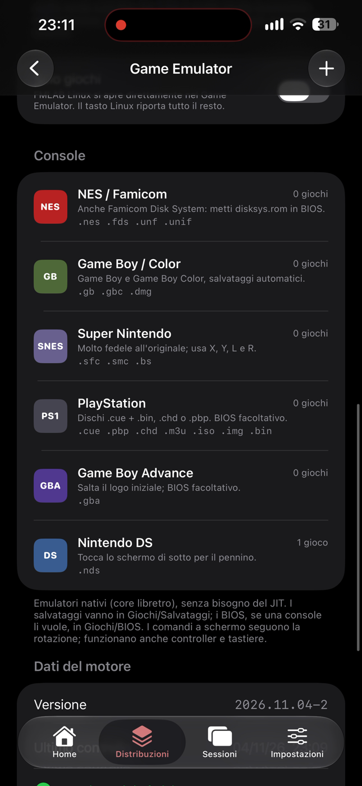
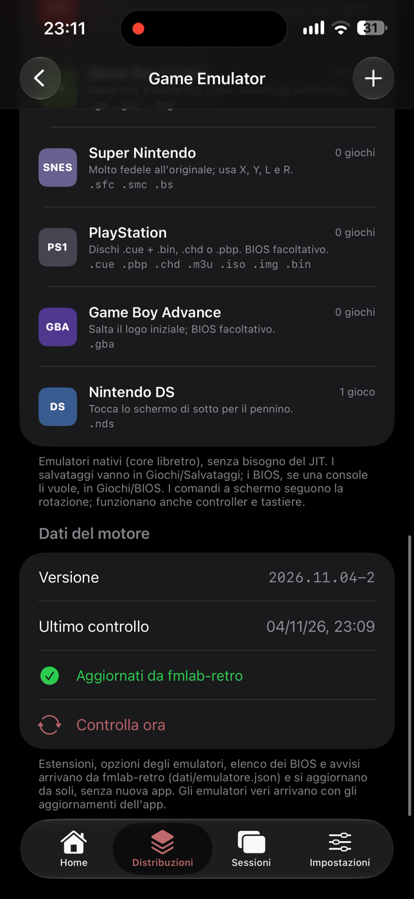
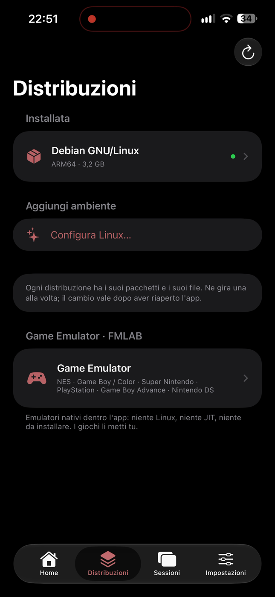
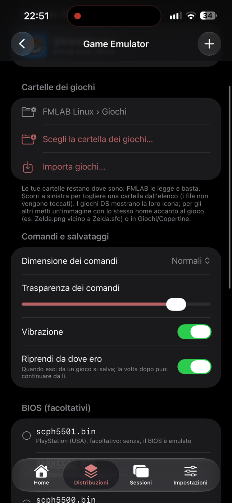

# FMLAB Retro 🎮

[🇮🇹 Italiano](README.md) · 🇬🇧 English

The **emulator factory** behind the Game Emulator of [FMLAB Linux](https://github.com/cipherdesk007-max/fmlab-Linux-io):
it builds the iPhone emulators the app ships with, plus the study that led to making them native.

> **No games included.** FMLAB neither ships nor downloads games: users add their own, only files they own or free
> homebrew.

The FMLAB Linux Game Emulator on an iPhone 15 Pro Max: engine data (version 2026.11.04-2) arrived from this repository without updating the app.

  
  
  
  

## The emulator disc

**Native iPhone** emulators (arm64, iOS 15+, **no JIT**) from the official libretro cores, the same ones RetroArch uses:
FCEUmm (NES), Gambatte (Game Boy/Color), mGBA (GBA), bsnes (SNES), PCSX ReARMed (PlayStation, interpreter), DeSmuME
(DS, interpreter).

1. [`core/core.tsv`](core/core.tsv) pins one commit per core.
2. GitHub ([core-ios](.github/workflows/core-ios.yml)) builds them, one `.framework` per core.
3. A **`core-<n>`** release ships `FMLAB-Core.zip`, its SHA-256 and `core.json` (source, size and checksum of each core).
4. FMLAB Linux pins tag and checksum in `app/FMLAB/Emulatore/DISCO`, verifies them on every build and embeds the
   emulators in the ipa, signed with the app.

They are built in because iOS only runs code signed with the app: a native emulator downloaded later would not start
without JIT.

## Engine data (updated without a new app)

[`dati/emulatore.json`](dati/emulatore.json) holds everything that is **not code**: extensions each emulator opens,
options (all JIT-free), BIOS files checked by MD5, notices. The Game Emulator downloads it from here (at most every 6
hours, when opened), validates it and uses it; offline it uses the last copy or the one built into the app. Editing
this file updates every phone **without a new app version**. GitHub's checks reject a malformed file.

Emulator code can't be updated this way: iOS only runs code signed with the app, so a new core ships with an FMLAB
Linux update (`core-<n>` disc).

## The study: why native

We first measured RetroArch **inside Debian** in FMLAB Linux ([`misura/misura.sh`](misura/misura.sh)). iPhone 15 Pro Max
without JIT, fps at 1x · 2x · 3x · full screen: NES 68 · 30 · 19 · 10, Game Boy 154 · 67 · 34 · 10, GBA 131 · 45 · 22 · 9
(60 = full speed). The interpreter costs 15–25×, so the Game Emulator runs the same cores natively.

## Automatic tests

On every change to `core/`, `dati/` or `prove/`, GitHub ([core-prova](.github/workflows/core-prova.yml)) builds the same
cores at the same commits for Linux and tests them with [`prove/banco.c`](prove/banco.c), which answers the cores like
the app's Game Emulator: every option in `dati/emulatore.json` must exist in the core with an accepted value, and with
free test games (240p Test Suite for NES, Game Boy and GBA, an FMLAB-made SNES ROM) the game must start, change screens
with simulated buttons, save and reload state.

## How it's checked

Every `core-<n>` has a published SHA-256 and the app refuses to build on a mismatch. Each core can be rebuilt from the
commit in `core/core.tsv`.

## License and credits

FMLAB Retro scripts: MIT. The cores keep their own licenses (GPL, MPL for mGBA) and come unmodified from the libretro
repositories above.
